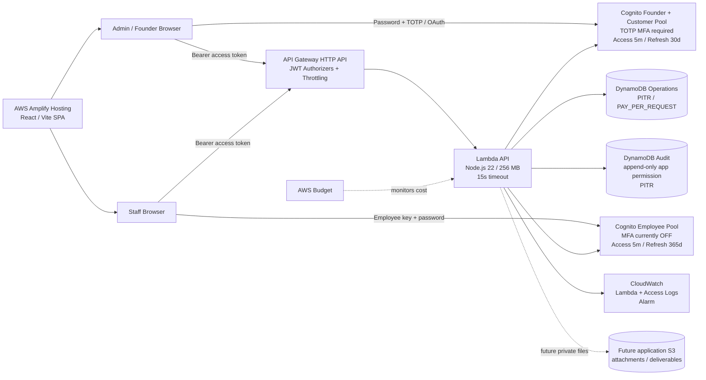

# รายงานวิเคราะห์เชิงลึกระบบ AZELVORI-STUDIO: Admin + Staff และความพร้อมสู่ Production

> **ติดตามความคืบหน้างานแก้ไข:** [Implementation Tracker](IMPLEMENTATION_TRACKER.md) — แยกสิ่งที่เสร็จแล้ว, กำลังตรวจ QA, และยังไม่ได้ทำ โดยไม่แก้ไขผลการตรวจ baseline ด้านล่าง
>
> **Research archive · 25 ตุลาคม 2026**
> 
> รายงานนี้ถอดความจาก Deep Research ฉบับสมบูรณ์และจัดรูปแบบใหม่สำหรับ GitHub โดย **ไม่ได้แก้ไขโค้ดหรือทดสอบระบบเพิ่มในขั้นตอนนำเข้ารายงาน**.
> Baseline: [`74bff07834b45c41073e1d6a59163af40964ba24`](https://github.com/tanawutmalirum29-ux/AZELVORI-STUDIO/commit/74bff07834b45c41073e1d6a59163af40964ba24).
> อ้างอิงแหล่งเอกสารภายนอกเป็นลิงก์ตรง ส่วน citation ภายใน Deep Research ที่ไม่สามารถเปิดจาก GitHub ได้ ถูกแทนด้วยลิงก์ไปยัง snapshot ของ repository; ลิงก์ดังกล่าวไม่ใช่ลิงก์ระดับบรรทัดของหลักฐาน.
> ข้อมูลสะท้อนช่วงเวลาที่ทำรายงาน ไม่ใช่การยืนยันสถานะ production แบบเรียลไทม์.


## Executive Summary

รายงานนี้ประเมินจากโค้ด `main` ปัจจุบันของ `AZELVORI-STUDIO` ที่ commit `74bff07834b45c41073e1d6a59163af40964ba24`, โครงสร้าง CDK, ระบบ authentication ฝั่งเว็บ, employee service, CI workflow, เอกสารการออกแบบภายใน repository, ตลอดจนหลักฐานการ Deploy จาก CloudShell ที่คุณส่งในบทสนทนา และเทียบกับแนวทางล่าสุดของ AWS, OWASP และ GitHub ณ วันที่ 25 ตุลาคม 2026. [หลักฐานจาก repository ณ commit](https://github.com/tanawutmalirum29-ux/AZELVORI-STUDIO/tree/74bff07834b45c41073e1d6a59163af40964ba24)

| ข้อสรุปสำคัญ | การประเมิน |
|---|---|
| **ฐานสถาปัตยกรรมดีกว่าระดับ prototype ทั่วไป** | มี Cognito แยก Staff, JWT authorizer, authorization ซ้ำใน Lambda, DynamoDB PITR + deletion protection, append-only application audit, idempotency สำหรับ chat, API throttling, CloudWatch access log, CSP/HSTS และ CDK guardrails อยู่แล้ว. [หลักฐานจาก repository ณ commit](https://github.com/tanawutmalirum29-ux/AZELVORI-STUDIO/tree/74bff07834b45c41073e1d6a59163af40964ba24) [หลักฐานจาก repository ณ commit](https://github.com/tanawutmalirum29-ux/AZELVORI-STUDIO/tree/74bff07834b45c41073e1d6a59163af40964ba24) |
| **ความเสี่ยงอันดับหนึ่งคือ “จำเครื่องนาน + refresh token ใน Web Storage”** | Staff เก็บ refresh token ไว้ใน `localStorage` สูงสุด 365 วัน และ admin/customer สูงสุด 30 วัน แม้ access token จะสั้นเพียง 5 นาทีก็ตาม. OWASP ปัจจุบันระบุชัดว่าไม่ควรเก็บ authentication/refresh token ใน `localStorage` หรือ `sessionStorage`; เป้าหมายระยะสั้นควรเป็น BFF + `HttpOnly; Secure; SameSite` cookie. [หลักฐานจาก repository ณ commit](https://github.com/tanawutmalirum29-ux/AZELVORI-STUDIO/tree/74bff07834b45c41073e1d6a59163af40964ba24) [หลักฐานจาก repository ณ commit](https://github.com/tanawutmalirum29-ux/AZELVORI-STUDIO/tree/74bff07834b45c41073e1d6a59163af40964ba24) |
| **Staff authentication ยังอ่อนกว่า Admin มาก** | Admin/founder pool บังคับ TOTP MFA แต่ Employee pool ตั้ง `mfa: OFF` ขณะที่ session staff อยู่ได้นานถึง 365 วัน. สำหรับระบบที่พนักงานเห็นข้อมูลลูกค้าและตอบแทนบริษัท ผมจัดเรื่อง Staff MFA เป็น **High priority ก่อน Production**. [หลักฐานจาก repository ณ commit](https://github.com/tanawutmalirum29-ux/AZELVORI-STUDIO/tree/74bff07834b45c41073e1d6a59163af40964ba24) |
| **Governance ของการ Deploy เป็นช่องว่างใหญ่** | CI ค่อนข้างดี แต่ไม่มี cloud deploy และ `main` ปัจจุบัน **ไม่ได้เปิด branch protection**; การ deploy ยังอาศัย CloudShell แบบ manual และในภาพมี CDK bootstrap-role assume warnings ซ้ำ ๆ ก่อน fallback ไปใช้ default credentials. GitHub รองรับ required PR reviews/status checks โดยตรง และ CDK ถูกออกแบบให้ deploy actor assume bootstrap roles. [หลักฐานจาก repository ณ commit](https://github.com/tanawutmalirum29-ux/AZELVORI-STUDIO/tree/74bff07834b45c41073e1d6a59163af40964ba24) [หลักฐานจาก repository ณ commit](https://github.com/tanawutmalirum29-ux/AZELVORI-STUDIO/tree/74bff07834b45c41073e1d6a59163af40964ba24) |
| **สถานะที่เหมาะสมตอนนี้คือ “แข็งแรงสำหรับ staging/pilot แต่ยังไม่ควรถือว่า production-ready”** | จุดที่ควรปิดก่อนเปิดลูกค้าจริงคือ session architecture, Staff MFA, per-employee authorization/assignment, live-cloud QA, protected deployment path, alert delivery, restore drill และ legal/privacy readiness. โค้ด CDK เองก็ยังบังคับว่า Production ต้องมี `legalReady`, budget email และ budget amount และ public intake เปิดไม่ได้หาก `legalReady=false`. [หลักฐานจาก repository ณ commit](https://github.com/tanawutmalirum29-ux/AZELVORI-STUDIO/tree/74bff07834b45c41073e1d6a59163af40964ba24) |

**คำตัดสินโดยรวม:** ผมไม่แนะนำให้ “รื้อใหม่” เพราะแกนหลักออกแบบมาดีแล้ว สิ่งที่ควรทำคือ **hardening รอบฐานเดิม** โดยเฉพาะ identity/session, authorization ต่อพนักงาน, observability และ deployment governance มากกว่าการเพิ่มฟีเจอร์จำนวนมากทันที.

## ฟีเจอร์และเส้นทางผู้ใช้

ระบบปัจจุบันมีการแยก identity boundary ของพนักงานออกจาก founder/customer อย่างถูกทิศทาง: Admin ใช้ founder/customer Cognito pool ที่บังคับ TOTP MFA ส่วน Staff ใช้ Employee Cognito pool แยกต่างหาก; staff token ไม่สามารถใช้กับ founder/customer routes ได้ และ backend ตรวจ active employee grant เพิ่มอีกชั้นในแต่ละ staff request. [หลักฐานจาก repository ณ commit](https://github.com/tanawutmalirum29-ux/AZELVORI-STUDIO/tree/74bff07834b45c41073e1d6a59163af40964ba24) [หลักฐานจาก repository ณ commit](https://github.com/tanawutmalirum29-ux/AZELVORI-STUDIO/tree/74bff07834b45c41073e1d6a59163af40964ba24)

### สถานะฟีเจอร์ปัจจุบัน

| เส้นทาง/ความสามารถ | สิ่งที่มีอยู่จริง | ช่องว่างที่สำคัญ |
|---|---|---|
| Admin login | Email/password + TOTP MFA; Hosted OAuth/PKCE เป็น fallback; access/ID token 5 นาที; refresh 30 วันเมื่อจำเครื่อง. [หลักฐานจาก repository ณ commit](https://github.com/tanawutmalirum29-ux/AZELVORI-STUDIO/tree/74bff07834b45c41073e1d6a59163af40964ba24) [หลักฐานจาก repository ณ commit](https://github.com/tanawutmalirum29-ux/AZELVORI-STUDIO/tree/74bff07834b45c41073e1d6a59163af40964ba24) | ไม่มีหน้า “อุปกรณ์/เซสชันที่กำลัง Login”, ไม่มี remote logout รายเครื่อง และ long-lived refresh ยังอยู่ใน browser storage |
| Staff login | Key + generated password, `USER_PASSWORD_AUTH`, “จำเครื่องนี้” default on, refresh ได้สูงสุด 365 วัน. [หลักฐานจาก repository ณ commit](https://github.com/tanawutmalirum29-ux/AZELVORI-STUDIO/tree/74bff07834b45c41073e1d6a59163af40964ba24) [หลักฐานจาก repository ณ commit](https://github.com/tanawutmalirum29-ux/AZELVORI-STUDIO/tree/74bff07834b45c41073e1d6a59163af40964ba24) | MFA ปิดอยู่, ไม่มี device registry, ไม่มี risk-based reauthentication |
| Admin employee management | สร้างพนักงานจากชื่อ/นามสกุล/ชื่อเล่น, แสดง password ครั้งเดียว, revoke key, reissue key เดิมให้ identity ใหม่. [หลักฐานจาก repository ณ commit](https://github.com/tanawutmalirum29-ux/AZELVORI-STUDIO/tree/74bff07834b45c41073e1d6a59163af40964ba24) | ไม่มี search/filter, last login/activity, device/session list, revocation reason, employee history, permissions/assignments |
| Reissue key | Key เดิม reuse ได้หลัง revoke; credential issuance ใหม่มี sequence ใหม่, password ใหม่ และ Cognito `sub` ใหม่; identity เดิมไม่กลับมาใช้. [หลักฐานจาก repository ณ commit](https://github.com/tanawutmalirum29-ux/AZELVORI-STUDIO/tree/74bff07834b45c41073e1d6a59163af40964ba24) | Admin UI ยังไม่แสดง “ประวัติคีย์นี้เคยเป็นของใครบ้าง” ซึ่งสำคัญต่อ audit |
| Staff inbox | ดูโปรเจกต์, อ่าน/ส่ง chat, ดู lead และ acknowledge งานใหม่; messages polling ทุก 15 วินาที. [หลักฐานจาก repository ณ commit](https://github.com/tanawutmalirum29-ux/AZELVORI-STUDIO/tree/74bff07834b45c41073e1d6a59163af40964ba24) | ไม่มี unread count, notification, real-time event, search, assignment, SLA, internal note, attachment |
| Revoke staff | Backend เปลี่ยน active grant เป็น false และพยายาม disable Cognito user; API ทุก staff request ตรวจ employee grant ซ้ำ. [หลักฐานจาก repository ณ commit](https://github.com/tanawutmalirum29-ux/AZELVORI-STUDIO/tree/74bff07834b45c41073e1d6a59163af40964ba24) | UI ที่ถูกเปิดไว้ตรวจ `/me` ทุก 60 วินาที ดังนั้นข้อมูลที่แสดงอยู่แล้วอาจยังค้างหน้าจอได้ช่วงหนึ่ง แม้ API ใหม่จะถูกปฏิเสธทันที. [หลักฐานจาก repository ณ commit](https://github.com/tanawutmalirum29-ux/AZELVORI-STUDIO/tree/74bff07834b45c41073e1d6a59163af40964ba24) |
| Customer/project chat | Transactional persistence, audit, paging, idempotency และ 15-second polling. [หลักฐานจาก repository ณ commit](https://github.com/tanawutmalirum29-ux/AZELVORI-STUDIO/tree/74bff07834b45c41073e1d6a59163af40964ba24) | ไม่มี internal team channel, presence, notifications, attachments และ inbox sorting ยังไม่อิง last message |

คำว่า **OTP ของ Admin** ควรสื่อใน UI ให้ชัดขึ้นว่า production configuration ปัจจุบันคือ **TOTP จาก Authenticator** ไม่ใช่ SMS OTP; code รองรับ challenge หลายชนิด แต่ Cognito pool ปัจจุบันตั้ง MFA required และเปิดเฉพาะ software-token OTP. [หลักฐานจาก repository ณ commit](https://github.com/tanawutmalirum29-ux/AZELVORI-STUDIO/tree/74bff07834b45c41073e1d6a59163af40964ba24) [หลักฐานจาก repository ณ commit](https://github.com/tanawutmalirum29-ux/AZELVORI-STUDIO/tree/74bff07834b45c41073e1d6a59163af40964ba24)

### UX ที่ควรเปลี่ยนก่อนเพิ่มฟีเจอร์ใหญ่

**Admin employee desk ควรกลายเป็น “Staff Access Console” มากกว่าแค่หน้าสร้างคีย์**

แต่ละแถวควรแสดง `ชื่อเล่น · ชื่อจริง · Key · Status · Last login · Last active · Created · Credential version` พร้อม filter `Active / Revoked`, search ชื่อหรือ key และปุ่ม “ดูประวัติ”. ปัจจุบัน UI แสดงเพียงชื่อ, key, active/revoked และวันที่สร้าง จึงยังไม่เพียงพอเมื่อมีพนักงานหลายคน. [หลักฐานจาก repository ณ commit](https://github.com/tanawutmalirum29-ux/AZELVORI-STUDIO/tree/74bff07834b45c41073e1d6a59163af40964ba24)

สำหรับ key ที่ reuse แล้ว ควรมี timeline เช่น:

```text
Key 00007
├─ v1  Somchai (Ton)     12 Nov – 19 Dec 2026    REVOKED
├─ v2  Narin (Nine)      20 Dec – 07 Feb 2027    REVOKED
└─ v3  Mali (May)        08 Feb 2027 – now        ACTIVE
```

ฐานข้อมูลมีข้อมูลเพียงพอที่จะรักษาประวัติ identity เก่า เพราะ reissue สร้าง Cognito subject ใหม่ และ application audit เก็บ `formerUserId`; สิ่งที่ขาดคือ API/UI สำหรับนำประวัตินั้นมาแสดง. [หลักฐานจาก repository ณ commit](https://github.com/tanawutmalirum29-ux/AZELVORI-STUDIO/tree/74bff07834b45c41073e1d6a59163af40964ba24)

หน้าที่แสดงรหัสผ่านครั้งเดียวควรเพิ่ม **Reveal/Hide**, **Copy key**, **Copy password**, “คัดลอกทั้งชุด”, warning ว่าอย่าส่งใน group chat และ confirmation “ฉันบันทึกรหัสแล้ว”. ปัจจุบัน credential ถูกวางใน `<input readOnly>` และบอกให้แอดมินจดหรือส่งช่องทางส่วนตัว ซึ่งทำงานได้แต่ UX ยังมีโอกาสให้ผู้ใช้ปิดหน้าก่อนบันทึก. [หลักฐานจาก repository ณ commit](https://github.com/tanawutmalirum29-ux/AZELVORI-STUDIO/tree/74bff07834b45c41073e1d6a59163af40964ba24)

ระยะถัดไปที่ปลอดภัยกว่าคือ **one-time onboarding handoff**: แอดมินสร้าง account แล้วได้ enrollment link/QR แบบ single-use ที่มีอายุสั้นสำหรับ “รับ credential ครั้งแรก” แทนการแสดง password ยาวบนจอแอดมินโดยตรง ทั้งนี้ “อายุ enrollment token” เป็นคนละเรื่องกับ “อายุบัญชีพนักงาน” จึงยังรักษาความต้องการของคุณที่ account ไม่มีวันหมดอายุอัตโนมัติได้.

**Staff desk ควรเปลี่ยนจาก “ทุกคนเห็นทุกอย่าง” เป็น assignment-based workspace.** เอกสาร V1 ระบุชัดว่าพนักงาน active ทุกคนปัจจุบันเห็น shared customer conversations และ intake queue ทั้งหมด และยังไม่มี per-assignee routing หรือ granular roles. [หลักฐานจาก repository ณ commit](https://github.com/tanawutmalirum29-ux/AZELVORI-STUDIO/tree/74bff07834b45c41073e1d6a59163af40964ba24)

ผมแนะนำโมเดลอย่างน้อย:

```text
FOUNDER_ADMIN
   ├── STAFF_LEAD       เห็นทุกโปรเจกต์ของทีม / assign งาน
   ├── PROJECT_MANAGER  เห็นเฉพาะโปรเจกต์ที่รับผิดชอบ
   └── SUPPORT          chat + lead ที่ถูก assign เท่านั้น
```

ไม่ควรใช้ “ซ่อนเมนูใน UI” เป็น authorization; backend ต้องเช็ก role + assignment ทุก request เช่นเดียวกับที่ระบบปัจจุบันตรวจ active employee grant อยู่แล้ว. แนวทางนี้สอดคล้องกับหลัก server-side authorization ที่ระบบปัจจุบันใช้อยู่. [หลักฐานจาก repository ณ commit](https://github.com/tanawutmalirum29-ux/AZELVORI-STUDIO/tree/74bff07834b45c41073e1d6a59163af40964ba24)

สำหรับ chat ลำดับ UX ที่คุ้มค่ากว่ารีบทำ WebSocket คือ **unread badge → sort by last message → assigned staff → desktop/browser notification → search → real-time transport**. ปัจจุบัน polling 15 วินาทีพอสำหรับ pilot และช่วยลด architecture complexity; WebSocket/AppSync ควรทำเมื่อ usage และความต้องการ “ทันที” พิสูจน์แล้ว. [หลักฐานจาก repository ณ commit](https://github.com/tanawutmalirum29-ux/AZELVORI-STUDIO/tree/74bff07834b45c41073e1d6a59163af40964ba24)

## สถาปัตยกรรม ความปลอดภัย และความทนทาน

### สถาปัตยกรรมที่มีอยู่จริง

จาก CDK ปัจจุบัน ระบบมี Operations DynamoDB และ Audit DynamoDB แบบ PAY_PER_REQUEST, PITR, deletion protection และ `RETAIN`; Cognito สอง user pools; HTTP API Gateway; Lambda Node.js 22 ขนาด 256 MB timeout 15 วินาที; CloudWatch application/access log; API alarm; optional monthly AWS Budget และ Amplify hosting. [หลักฐานจาก repository ณ commit](https://github.com/tanawutmalirum29-ux/AZELVORI-STUDIO/tree/74bff07834b45c41073e1d6a59163af40964ba24) [หลักฐานจาก repository ณ commit](https://github.com/tanawutmalirum29-ux/AZELVORI-STUDIO/tree/74bff07834b45c41073e1d6a59163af40964ba24)



แผนภาพนี้แยก **application S3** ออกจาก CDK bootstrap S3 ให้ชัดเจน: จาก application CDK ปัจจุบันยังไม่มี S3 bucket สำหรับไฟล์ลูกค้า/deliverables; เอกสาร implementation ระบุ private S3 quarantine/download เป็นงานอนาคต ขณะที่ CDK bootstrap มี S3 asset bucket สำหรับ Lambda/CDK assets อยู่แล้ว. [หลักฐานจาก repository ณ commit](https://github.com/tanawutmalirum29-ux/AZELVORI-STUDIO/tree/74bff07834b45c41073e1d6a59163af40964ba24) **Amplify** build ด้วย Node 22 และ `npm ci --ignore-scripts`; repository เองกำหนด `engines.node >=22.14`. ดังนั้นสมมติฐาน “Node >=20” ไม่ตรงกับสถานะจริงของ repository แล้ว: สำหรับ AZELVORI ตอนนี้ควรถือ **Node 22.14+ เป็น baseline**. [หลักฐานจาก repository ณ commit](https://github.com/tanawutmalirum29-ux/AZELVORI-STUDIO/tree/74bff07834b45c41073e1d6a59163af40964ba24) [หลักฐานจาก repository ณ commit](https://github.com/tanawutmalirum29-ux/AZELVORI-STUDIO/tree/74bff07834b45c41073e1d6a59163af40964ba24)

ภาพ CloudShell ของคุณใช้ Node `v20.20.2` และเกิด AWS SDK warning ว่ารุ่นใหม่หลังต้นปี 2027 จะต้องการ Node >=22. AWS SDK for JavaScript ได้ประกาศให้รอบ support เดินตาม Node.js lifecycle แล้ว จึงควรอัป CloudShell/tooling เป็น Node 22 ตอนนี้ ไม่ควรรอให้ installation/build แตกในปี 2027. ### สิ่งที่ออกแบบมาดีและควรรักษา

DynamoDB สองตารางมี PITR, deletion protection และ `RETAIN`; นี่เป็น baseline ที่ดีมากสำหรับระบบธุรกิจ. AWS ระบุว่า PITR สามารถ restore ไปยังเวลาใน recovery window สูงสุด 35 วันได้ และการ restore จะสร้าง **ตารางใหม่** ไม่ได้เขียนทับตารางต้นฉบับ. [หลักฐานจาก repository ณ commit](https://github.com/tanawutmalirum29-ux/AZELVORI-STUDIO/tree/74bff07834b45c41073e1d6a59163af40964ba24) Audit table ถูกให้ application Lambda เพียง `dynamodb:PutItem` ไม่มี Update/Delete ขณะที่ operations table ได้เฉพาะ Get/Put/Update/Query/ConditionCheck ไม่มี Scan/DeleteItem. นี่เป็น least-privilege decision ที่ดี และควรรักษาเมื่อแยก Lambda ในอนาคต. [หลักฐานจาก repository ณ commit](https://github.com/tanawutmalirum29-ux/AZELVORI-STUDIO/tree/74bff07834b45c41073e1d6a59163af40964ba24)

API Gateway มี structured access log ที่บันทึก `requestId`, route, status, latency และมี default throttling: staging/shared `2 req/s` burst `5`; reserved mode `10 req/s` burst `20`. AWS ยืนยันว่า HTTP APIs รองรับ stage/route throttling และเมื่อเกิน target จะตอบ `429`; ค่าดังกล่าวเป็น best-effort limits ไม่ใช่ hard cost ceiling. [หลักฐานจาก repository ณ commit](https://github.com/tanawutmalirum29-ux/AZELVORI-STUDIO/tree/74bff07834b45c41073e1d6a59163af40964ba24) Security headers ฝั่ง Amplify ก็ดีกว่าค่า default ทั่วไป: HSTS, `X-Frame-Options: DENY`, `nosniff`, no-referrer, restrictive permissions policy และ CSP ที่จำกัด `script-src 'self'`. สิ่งนี้ช่วยลด XSS/clickjacking surface แต่ไม่สามารถทำให้ Web Storage เป็นที่เก็บ refresh token ที่ปลอดภัยได้หาก same-origin JavaScript ถูก compromise. [หลักฐานจาก repository ณ commit](https://github.com/tanawutmalirum29-ux/AZELVORI-STUDIO/tree/74bff07834b45c41073e1d6a59163af40964ba24) ### จุดเสี่ยงด้าน Session และ Authentication

ปัจจุบันทั้ง admin native login และ staff login persist refresh token ลง `localStorage` เมื่อเลือกจำเครื่อง และ active tab ยังเก็บ token set ใน `sessionStorage`. Access/ID JWT อายุ 5 นาที แต่ refresh credential ของ staff อยู่ได้ 365 วัน ส่วน founder/customer 30 วัน. [หลักฐานจาก repository ณ commit](https://github.com/tanawutmalirum29-ux/AZELVORI-STUDIO/tree/74bff07834b45c41073e1d6a59163af40964ba24) [หลักฐานจาก repository ณ commit](https://github.com/tanawutmalirum29-ux/AZELVORI-STUDIO/tree/74bff07834b45c41073e1d6a59163af40964ba24) [หลักฐานจาก repository ณ commit](https://github.com/tanawutmalirum29-ux/AZELVORI-STUDIO/tree/74bff07834b45c41073e1d6a59163af40964ba24)

นี่คือ **ความเสี่ยงสูงสุดของระบบปัจจุบัน** เพราะ OWASP Session Management guidance ฉบับปัจจุบันระบุไม่ให้เก็บ authentication tokens, session IDs, JWTs หรือ refresh tokens ใน `localStorage`/`sessionStorage`; JavaScript ใด ๆ ที่ execute ใน origin เดียวกันสามารถอ่านได้ และแนวทางที่แนะนำคือ `HttpOnly; Secure; SameSite` cookie หรือ Backend-for-Frontend. โครงสร้างเป้าหมายที่ผมแนะนำคือ:

```text
Browser
  │
  │ HttpOnly Secure SameSite cookie
  ▼
Session/BFF Lambda
  │
  ├── server-side refresh credential / hashed opaque session
  ├── Cognito refresh
  └── calls internal API
```

ในโมเดลนี้ JavaScript ฝั่งหน้าเว็บไม่สามารถอ่าน refresh credential ได้ แม้ XSS จะยังสามารถ “สั่ง request” ในนามผู้ใช้ได้บางรูปแบบ ความเสียหายจากการขโมย credential เพื่อนำไป replay จากเครื่องอื่นจะลดลงอย่างมีนัยสำคัญ. แนวคิด server-side session และ opaque identifiers สอดคล้องกับ OWASP session guidance. **Staff MFA ควรเพิ่ม.** Founder pool บังคับ TOTP อยู่แล้ว แต่ Employee pool ตั้ง `mfa: OFF`. การออก password แบบ random ยาวช่วยลด password guessing มาก แต่ไม่ป้องกัน credential theft, phishing, clipboard leak หรือเครื่องพนักงานถูกขโมย; OWASP จัด MFA เป็น defense หลักต่อ password-based account takeover. [หลักฐานจาก repository ณ commit](https://github.com/tanawutmalirum29-ux/AZELVORI-STUDIO/tree/74bff07834b45c41073e1d6a59163af40964ba24) การแก้ UX ไม่จำเป็นต้องทำให้พนักงานกรอก MFA ทุกวัน: ให้ MFA ตอน **first device enrollment / new device / suspicious sign-in** แล้วใช้ trusted-device session ที่ backend ควบคุมต่อได้ หรือใช้ Cognito adaptive threat protection หากยอมใช้ Plus plan. Cognito รองรับ risk scoring, block/require MFA และ AWS แนะนำเริ่ม audit-only ก่อนเปิด enforcement. ### Token lifecycle และ replay

ระบบปัจจุบันเปิด Cognito token revocation แต่ยัง **ไม่ได้เปิด refresh-token rotation** และ frontend ต่ออายุด้วย `REFRESH_TOKEN_AUTH`. AWS ระบุว่าเมื่อเปิด rotation ต้องเปลี่ยนไปใช้ `GetTokensFromRefreshToken`; flow `REFRESH_TOKEN_AUTH` ใช้กับ rotation-enabled client ไม่ได้. [หลักฐานจาก repository ณ commit](https://github.com/tanawutmalirum29-ux/AZELVORI-STUDIO/tree/74bff07834b45c41073e1d6a59163af40964ba24) [หลักฐานจาก repository ณ commit](https://github.com/tanawutmalirum29-ux/AZELVORI-STUDIO/tree/74bff07834b45c41073e1d6a59163af40964ba24) ดังนั้นเส้นทางที่เหมาะสมคือ **BFF ก่อน แล้ว refresh rotation** หรือหาก BFF ต้องเลื่อนไป ให้เปลี่ยน Cognito refresh flow เป็น `GetTokensFromRefreshToken` และเปิด rotation + grace period สั้น ๆ เป็น hardening ชั่วคราว. Rotation ลดประโยชน์ของ refresh token ที่ถูกขโมยและถูกใช้ซ้ำ แต่ไม่แก้ XSS root cause จึงไม่ควรถูกมองว่าแทน HttpOnly session ได้. โมเดล revoke/reissue ของ employee กลับทำได้ดี: revoke เปลี่ยน database grant เป็น inactive, backend ตรวจ grant ทุก request, Cognito identity ถูก disable และ reissue สร้าง subject ใหม่ ไม่เปิด identity เก่ากลับมา. เพราะ JWT เป็น self-contained token การมี server-side grant check แบบนี้สำคัญมาก; AWS เตือนว่า JWT ที่ถูก revoke ยังอาจผ่าน library ที่ตรวจเพียง signature และ expiry ได้. [หลักฐานจาก repository ณ commit](https://github.com/tanawutmalirum29-ux/AZELVORI-STUDIO/tree/74bff07834b45c41073e1d6a59163af40964ba24) สำหรับ incident ร้ายแรงควรเพิ่ม `AdminUserGlobalSignOut`/global sign-out path ด้วย เพราะ AWS มี operation สำหรับ invalidate refresh, ID และ access tokens ของ user ทั้งหมดจากฝั่ง administrator. ### Password และ credential issuance

Employee credential generation แข็งแรง: ทุก issuance มี atomic sequence แยกต่างหาก, password รูปแบบ `AZb-{issuance}-{key}-{random}` ใช้ `randomBytes(22)` และ plaintext password ไม่ถูกเก็บลง application DB. Reissue ใช้ Cognito user ใหม่ และ conditional database write ป้องกัน concurrent reissue เปิดสอง identity สำหรับ key เดียวกัน. [หลักฐานจาก repository ณ commit](https://github.com/tanawutmalirum29-ux/AZELVORI-STUDIO/tree/74bff07834b45c41073e1d6a59163af40964ba24)

สิ่งที่ยังควรแก้คือ **idempotency ของ credential creation**. Chat POST มี `Idempotency-Key` แต่หน้า Admin employee creation/reissue ไม่ส่ง idempotency key. หาก `POST /admin/employees` สำเร็จบน server แต่ response หลุดกลางทาง แล้วแอดมินกดสร้างใหม่ อาจเกิด issuance ใหม่อีกชุดแทนที่จะคืนผลเดิม. นี่เป็น inference จาก client/API code ปัจจุบันและควรแก้ด้วย idempotency record สำหรับ employee issuance เช่นเดียวกับ chat. [หลักฐานจาก repository ณ commit](https://github.com/tanawutmalirum29-ux/AZELVORI-STUDIO/tree/74bff07834b45c41073e1d6a59163af40964ba24) [หลักฐานจาก repository ณ commit](https://github.com/tanawutmalirum29-ux/AZELVORI-STUDIO/tree/74bff07834b45c41073e1d6a59163af40964ba24)

### Scaling, Lambda และ DynamoDB

Lambda ปัจจุบันเป็น function เดียวสำหรับ public/admin/customer/staff routes, memory 256 MB, timeout 15 วินาที. Staging ใช้ `shared`; CDK guardrail ไม่ยอมให้ `shared` ใน production หรือ staging ที่เปิด public intake ส่วน reserved mode จำกัด function ที่ 5 concurrent executions. [หลักฐานจาก repository ณ commit](https://github.com/tanawutmalirum29-ux/AZELVORI-STUDIO/tree/74bff07834b45c41073e1d6a59163af40964ba24)

**Reserved concurrency ไม่ได้กำจัด cold start**; มันใช้กำหนด/กัน concurrency ส่วน provisioned concurrency สร้าง execution environments ที่ initialize ไว้ล่วงหน้าและมีค่าใช้จ่ายเพิ่ม. AWS แนะนำ provisioned concurrency เมื่อ workload ต้องการ latency สม่ำเสมอ และภายใน provisioned capacity ไม่ควรมี cold start. ดังนั้นไม่ควรเปิด Provisioned Concurrency ทันที. ขั้นตอนที่ถูกคือวัด p50/p95/p99 duration และ cold-start frequency ก่อน; หาก admin/staff chat latency มีปัญหาจริง ค่อยใช้ provisioned concurrency `1–2` บน production alias หรือแยก private interactive Lambda ออกจาก public intake.

เมื่อระบบโตขึ้น ผมแนะนำแยกอย่างน้อย:

```text
Public Intake Lambda
Private Workspace Lambda
Identity / Admin Control Lambda
```

ไม่จำเป็นต้องแตกเป็น microservices จำนวนมาก แต่การมี Lambda เดียวทำให้ traffic จาก public lead/message สามารถแย่ง concurrency กับ admin control plane ได้ และทุก backend change มี blast radius ครอบคลุมทุก route.

DynamoDB employee new-key counter และ credential-issuance counter ปัจจุบันเป็น atomic writes ไปที่ record เดียว (`SEQUENCE#EMPLOYEE` และ `SEQUENCE#EMPLOYEE_CREDENTIAL`). นี่เป็น **potential hot-item pattern** หากวันหนึ่งมี bulk issuance ขนาดใหญ่ แต่สำหรับสตูดิโอที่สร้าง account พนักงานเป็นครั้งคราว ความเสี่ยงจริงต่ำมาก จึงเป็น Low priority; ไม่ควรเพิ่ม complexity ตอนนี้. [หลักฐานจาก repository ณ commit](https://github.com/tanawutmalirum29-ux/AZELVORI-STUDIO/tree/74bff07834b45c41073e1d6a59163af40964ba24)

สิ่งที่สำคัญกว่าคือ **restore drill**. PITR เปิดแล้ว แต่ AWS ระบุว่าการ restore สร้างตารางใหม่ และบาง configuration เช่น TTL, alarms, tags, stream และ PITR ของ destination ต้องตั้งใหม่เอง. ดังนั้น “มี backup” ยังไม่เท่ากับ “restore ได้จริงภายใน RTO”. ## การทดสอบ CI/CD และความเสี่ยงการ Deploy

CI ปัจจุบันถือว่าดีสำหรับ repository ขนาดนี้: GitHub Actions ใช้ Node 22, `npm ci --ignore-scripts`, build, hosting verification, unit tests, CDK synth, `npm audit --audit-level=high`, Playwright Chromium/WebKit, workspace E2E และเก็บ test/build/CDK artifacts 14 วัน; Actions ถูก pin ด้วย commit SHA และ workflow ไม่มี AWS credentials. [หลักฐานจาก repository ณ commit](https://github.com/tanawutmalirum29-ux/AZELVORI-STUDIO/tree/74bff07834b45c41073e1d6a59163af40964ba24)

จุดอ่อนคือ **CI ที่ดีไม่ได้ถูกบังคับด้วย branch governance**. GitHub API ของ repository ปัจจุบันรายงาน `main.protected=false`, protection disabled และไม่มี required status checks. นั่นหมายความว่าความถูกต้องของกระบวนการยังขึ้นกับวินัยของผู้ deploy มากกว่ากฎที่ platform บังคับ. [หลักฐานจาก repository ณ commit](https://github.com/tanawutmalirum29-ux/AZELVORI-STUDIO/tree/74bff07834b45c41073e1d6a59163af40964ba24)

GitHub branch protection สามารถบังคับ PR approval, required status checks, conversation resolution, signed commits, linear history, deployment success และห้าม bypass ได้ จึงควรเปิดอย่างน้อย required CI + PR before merge บน `main`. ### ช่องว่าง QA ที่ควรปิด

| พื้นที่ | ตอนนี้ | สิ่งที่ควรเพิ่ม |
|---|---|---|
| Unit | มี Vitest และ coverage ของ auth/domain หลายส่วนตาม test tree/CI. [หลักฐานจาก repository ณ commit](https://github.com/tanawutmalirum29-ux/AZELVORI-STUDIO/tree/74bff07834b45c41073e1d6a59163af40964ba24) | เพิ่ม coverage threshold และ mutation/negative tests ใน authorization-sensitive code |
| Integration | มี API/domain/Dynamo integration ใน source test suite. [หลักฐานจาก repository ณ commit](https://github.com/tanawutmalirum29-ux/AZELVORI-STUDIO/tree/74bff07834b45c41073e1d6a59163af40964ba24) | Test idempotency employee create, concurrent reissue/revoke, refresh replay |
| Browser E2E | Chromium + WebKit. [หลักฐานจาก repository ณ commit](https://github.com/tanawutmalirum29-ux/AZELVORI-STUDIO/tree/74bff07834b45c41073e1d6a59163af40964ba24) | เพิ่ม Firefox ถ้าจะ support และ mobile viewport/accessibility regression |
| Auth E2E | synthetic Cognito/API responses. [หลักฐานจาก repository ณ commit](https://github.com/tanawutmalirum29-ux/AZELVORI-STUDIO/tree/74bff07834b45c41073e1d6a59163af40964ba24) | **Live staging test** กับ Cognito จริง: login, TOTP, refresh, remembered device, revoke, reissue |
| Infrastructure | `cdk synth` ใน CI. [หลักฐานจาก repository ณ commit](https://github.com/tanawutmalirum29-ux/AZELVORI-STUDIO/tree/74bff07834b45c41073e1d6a59163af40964ba24) | Policy assertions: deletion protection/PITR/MFA/no public S3/no wildcard IAM; security diff artifact |
| Deploy | Manual CloudShell | Environment approval → deploy → smoke → rollback gate |
| Recovery | PITR enabled | Quarterly restore drill + documented RTO/RPO |

จุดที่ควรสร้างเป็น **production acceptance test** คือ:

```text
Admin login + TOTP
→ create test employee
→ Staff login
→ send chat
→ acknowledge lead
→ close key while staff browser remains open
→ API must become 403 immediately
→ old password login must fail
→ reissue same numeric key
→ new password succeeds
→ old session must still fail
```

เอกสาร Employee V1 เองระบุว่าปัจจุบัน browser tests ใช้ synthetic Cognito/API responses และ live Cognito access/Lambda audit verification ยังต้องทำแยก จึงควรยกระดับ flow นี้เป็น automated staging smoke หรืออย่างน้อย release gate ที่ reproducible. [หลักฐานจาก repository ณ commit](https://github.com/tanawutmalirum29-ux/AZELVORI-STUDIO/tree/74bff07834b45c41073e1d6a59163af40964ba24)

### ความเสี่ยงของการ Deploy แบบปัจจุบัน

จากภาพ CloudShell ที่คุณส่ง มี warning ซ้ำ ๆ ว่า credentials ปัจจุบัน assume `cdk-hnb659fds-lookup-role`, `deploy-role` และ `file-publishing-role` ไม่ได้ แต่ CDK เห็นว่าอยู่ใน account ถูกต้องและดำเนินการด้วย default credentials ต่อ. การ deploy สำเร็จ ไม่ได้แปลว่า configuration นี้เหมาะกับ production.

ตาม CDK design ปกติ deployment actor ควร assume DeploymentActionRole, FilePublishingRole และ LookupRole ที่ bootstrap สร้างไว้; role trust/permissions เป็นส่วนหนึ่งของ security boundary. ดังนั้น warning ของคุณ **น่าจะ** หมายถึง principal policy หรือ trust policy ไม่สอดคล้องกับ bootstrap contract และควรตรวจแก้ แทนที่จะยอมรับ fallback ระยะยาว. ไม่ควร `cdk bootstrap` ซ้ำแบบสุ่มเพื่อกำจัด warning. ควร inspect `CDKToolkit` และ role trust ก่อน เพราะ bootstrap customization มีผลต่อ permissions ของ deploy/CloudFormation roles. สำหรับ production ผมแนะนำเส้นทาง:

```text
Pull Request
   ↓
Required CI
   ↓
Merge protected main
   ↓
Build immutable artifact
   ↓
CDK Diff / Change Set artifact
   ↓
Manual Environment Approval
   ↓
AWS deploy role via OIDC
   ↓
Post-deploy live smoke
   ↓
Promote / rollback
```

CloudFormation/CDK มี rollback เปิดเป็นค่า default เมื่อ deployment ล้มเหลว แต่ rollback infrastructure **ไม่สามารถย้อน business data mutations ที่เกิดระหว่าง release ได้**; schema/API changes จึงต้อง backward-compatible และ data migration ต้องมีแผนแยก. CDK ยังรองรับ `--require-approval` และ drift-aware deployments. สำหรับ production จริง การแยก production กับ non-production เป็น AWS account คนละ account จะดีกว่าใช้เพียง stack name ต่างกันใน account เดียว เพราะ AWS Well-Architected แนะนำ account-level isolation สำหรับ production/development/test เพื่อจำกัด blast radius, IAM และ billing boundary. ## การปฏิบัติการ Monitoring และ Incident

ระบบไม่ได้เริ่มจากศูนย์ในด้าน observability: มี Lambda log group และ API access log group retention 1 เดือน, JSON access logs, Lambda `Errors` alarm ที่ threshold 3 errors ใน 5 นาที และ CDK รองรับ monthly budget 50/80/100% เมื่อกำหนด `budgetEmail`/`budgetUsd`. [หลักฐานจาก repository ณ commit](https://github.com/tanawutmalirum29-ux/AZELVORI-STUDIO/tree/74bff07834b45c41073e1d6a59163af40964ba24)

แต่ Alarm ปัจจุบันมีเพียงคำอธิบายว่าให้ต่อ operational notification ก่อนเปิด intake และใน CDK ที่ตรวจไม่พบ alarm action/SNS destination. ดังนั้น alarm อาจเปลี่ยน state โดยไม่มีใครได้รับแจ้ง ซึ่งควรถือเป็น **High priority operational gap**. [หลักฐานจาก repository ณ commit](https://github.com/tanawutmalirum29-ux/AZELVORI-STUDIO/tree/74bff07834b45c41073e1d6a59163af40964ba24)

CloudWatch/Lambda มี metrics พื้นฐานอย่าง `Invocations`, `Duration`, `Errors`, `Throttles`; ควรทำ dashboard + alarms จากชุดเหล่านี้แทนการดูเพียง error count. ผมเสนอ baseline production monitoring ดังนี้:

| Signal | Suggested Alert | เหตุผล |
|---|---:|---|
| API `5xx` | ≥ 3 ภายใน 5 นาที หรือ >2% | backend/release failure |
| API p95 latency | > 1.5–2s ต่อเนื่อง 10 นาที | UX degradation |
| Lambda Errors | ≥ 3/5m | มีอยู่แล้ว แต่ต้องต่อ notification |
| Lambda Throttles | > 0 ต่อเนื่อง 5 นาที | reserved concurrency อาจต่ำเกิน |
| Lambda Duration | p95 > 70% ของ 15s timeout | เสี่ยง timeout |
| DynamoDB throttled requests | > 0 ต่อเนื่อง | partition/capacity issue |
| Staff/Admin 401/403 surge | baseline ×3 | token/auth/revoke anomaly |
| Cognito sign-in failure surge | baseline ×3 | credential attack/incident |
| Cost | budget 50/80/100% + anomaly | ป้องกัน cost surprise |

ตัวเลขข้างต้นเป็น **starting thresholds** ไม่ใช่มาตรฐานตายตัว; หลังเก็บ baseline 2–4 สัปดาห์ควร tune จาก traffic จริง.

ใน CDK ปัจจุบันที่ตรวจไม่พบ Lambda active tracing/X-Ray configuration. สำหรับระบบที่ API Gateway → Lambda → DynamoDB/Cognito หลายชั้น ควรเปิด active tracing หรือ OpenTelemetry/Powertools เพื่อแยกได้ว่า latency มาจาก init, DynamoDB, Cognito หรือ code path ใด. AWS Lambda Powertools Tracer รองรับ AWS SDK v3 และ cold-start annotations. [หลักฐานจาก repository ณ commit](https://github.com/tanawutmalirum29-ux/AZELVORI-STUDIO/tree/74bff07834b45c41073e1d6a59163af40964ba24) Cost controls ปัจจุบันมี budget primitive ที่ดีอยู่แล้ว แต่ควรเพิ่ม Cost Anomaly Detection เพราะ AWS สามารถ monitor unusual spend และส่ง notification ผ่าน email/SNS/User Notifications ได้. ### Runbook เมื่อพนักงานหรืออุปกรณ์มีปัญหา

| เหตุการณ์ | การตอบสนองที่ควรเป็นมาตรฐาน |
|---|---|
| พนักงานลาออก/หมดสิทธิ์ | Admin กดปิด key → DB grant inactive → Cognito disable → ตรวจ API จาก session เดิมว่าตอบ 403 → เก็บ actor/time/reason ใน audit |
| Password พนักงานหลุด | ปิด key ทันที → global sign-out/disable identity → reissue key เดิมเป็น Cognito identity ใหม่ → ห้ามเปิด identity เก่ากลับมา |
| โทรศัพท์/Notebook พนักงานหาย | revoke trusted-device/session หรือปิด key หากยังไม่มี per-device revocation → ตรวจ audit/API access จาก session นั้น |
| Admin device หาย | Cognito AdminUserGlobalSignOut → password reset → ตรวจ TOTP/device → ตรวจ audit/CloudTrail ก่อนออก session ใหม่ |
| Deployment error spike | freeze deploy → inspect CloudFormation events + Lambda logs → rollback code/infrastructure → live smoke |
| DynamoDB accidental write | stop writer → ระบุ restore point → PITR ไป table ใหม่ → verify TTL/index/alarms/permissions → controlled cutover |

AWS ระบุว่า AdminUserGlobalSignOut invalidates refresh/ID/access tokens ที่ Cognito ออกให้ user และ DynamoDB PITR restore ไป table ใหม่ จึงควรซ้อม runbook สองกรณีนี้จริงก่อน production. ## Roadmap และ Prioritization

ประมาณ effort ด้านล่างเป็น **คน-วัน (person-days)** สำหรับ developer ที่คุ้นกับ codebase นี้แล้ว รวม implementation + test แต่ไม่รวมเวลารอ legal review หรือ procurement.

### ตารางข้อเสนอหลัก

| Issue | Risk | Recommendation | Priority | Estimated Effort |
|---|---|---|---|---:|
| Refresh token 365d/30d ใน Web Storage | XSS/compromised JS อาจขโมย durable credential. | ทำ BFF + HttpOnly/Secure/SameSite session; เก็บ Cognito refresh server-side | **High** | 8–12 วัน |
| Staff MFA = OFF | credential/device theft นำไป account takeover ได้ง่ายขึ้น. [หลักฐานจาก repository ณ commit](https://github.com/tanawutmalirum29-ux/AZELVORI-STUDIO/tree/74bff07834b45c41073e1d6a59163af40964ba24) | TOTP หรือ passkey/new-device MFA; trusted device หลัง MFA | **High** | 3–5 วัน |
| `main` ไม่ protected | code อาจเข้า main โดยไม่ผ่าน required CI/review. [หลักฐานจาก repository ณ commit](https://github.com/tanawutmalirum29-ux/AZELVORI-STUDIO/tree/74bff07834b45c41073e1d6a59163af40964ba24) | Required PR + CI + no force push + stale review protection | **High** | 0.5–1 วัน |
| Manual CloudShell + assume-role warnings | human error / deploy privilege boundary ไม่ชัด | แก้ CDK bootstrap role trust; deploy ผ่าน OIDC role + environment approval | **High** | 2–4 วัน |
| CI auth เป็น synthetic | release อาจผ่าน CI แต่ Cognito/live AWS fail | Live staging smoke auth/revoke/reissue | **High** | 2–4 วัน |
| Alarm ไม่มี notification action | outage อาจเกิดโดยไม่มีผู้รู้ | SNS/User Notifications + dashboard + runbook | **High** | 2–3 วัน |
| Staff ทุกคนเห็นทุก project/lead | privacy/least privilege risk. [หลักฐานจาก repository ณ commit](https://github.com/tanawutmalirum29-ux/AZELVORI-STUDIO/tree/74bff07834b45c41073e1d6a59163af40964ba24) | employee roles + project/lead assignment + server-side authorization | **High** | 6–10 วัน |
| ไม่มี session/device console | เครื่องหายต้อง revoke ทั้ง account/key | device/session registry + revoke one/all + last activity | **High** | 5–8 วัน |
| Refresh token rotation ไม่ได้เปิด | stolen refresh token reuse window ยาว | หลัง/BFF พร้อม เปิด rotation + `GetTokensFromRefreshToken` | **Medium** | 2–4 วัน |
| Employee creation ไม่มี idempotency | response loss อาจสร้าง credential ซ้ำ | Idempotency-Key + durable issuance result | **Medium** | 2–3 วัน |
| Chat polling + no unread/notifications | response workflow ช้าเมื่อทีมโต | unread/last-message/notification ก่อน WebSocket | **Medium** | 4–7 วัน |
| Single Lambda ทุก route | noisy workload แชร์ concurrency/blast radius | แยก public intake / private workspace เมื่อ traffic โต | **Medium** | 5–8 วัน |
| ไม่มี distributed tracing | debugging latency ยาก | X-Ray/OTel/Powertools | **Medium** | 2–3 วัน |
| PITR แต่ยังไม่มี restore drill | backup อาจใช้จริงไม่ทัน incident | quarterly restore exercise + RTO/RPO | **Medium** | 1–2 วัน/รอบ |
| ไม่มี app S3 สำหรับ attachments | ฟีเจอร์ไฟล์ยังไม่พร้อม | Private S3, versioning, presigned URLs, quarantine/scan | **Medium** | 6–10 วัน |
| Employee sequence เป็น global hot item | scale สูงมากอาจรวม write ที่ item เดียว | ยังไม่แก้จนมี issuance volume สูง | **Low** | 2–4 วันถ้าจำเป็น |
| CloudShell Node 20 | ไม่ตรง project engine >=22.14 และกำลังเข้าสู่ unsupported SDK path. [หลักฐานจาก repository ณ commit](https://github.com/tanawutmalirum29-ux/AZELVORI-STUDIO/tree/74bff07834b45c41073e1d6a59163af40964ba24) | standardize Node 22.14+ ทุก environment | **High/ง่าย** | <0.5 วัน |

### แผนสามสิบวันแรก

ช่วงนี้ควรเน้น **security/control plane** มากกว่าฟีเจอร์ลูกค้าใหม่: protected main, Node 22, fix CDK role assumptions, alarm delivery, Staff MFA, live AWS auth/revoke smoke และเริ่ม BFF/session migration. เป้าหมายคือทำให้ “คนอื่นเข้าแทนไม่ได้ง่าย และ deploy ผิดยาก”. แนวทาง branch protection, CDK role-based deployment และ HttpOnly session มีฐานจาก GitHub/AWS/OWASP โดยตรง. ### แผนหกสิบวัน

เน้น **least privilege + operational UX**: employee roles, project/lead assignment, device/session management, audit history ของ reused key, employee issuance idempotency, unread/last-message sorting และ restore drill. จุดนี้จะเปลี่ยน staff workspace จาก “ทุกคนคือพนักงานสิทธิ์เท่ากัน” เป็นระบบที่รองรับทีมจริง.

### แผนเก้าสิบวัน

เน้น **production scale and experience**: tracing, split Lambda ตาม blast radius, notifications/realtime ตามความจำเป็น, Cognito threat protection audit, private S3 attachments/deliverables, separate production AWS account และ audit archival ที่แข็งแรงขึ้น. AWS แนะนำ production/non-production isolation ด้วย multi-account strategy. ```mermaid
gantt
    title AZELVORI-STUDIO — 90-Day Production Hardening Roadmap
    dateFormat YYYY-MM-DD
    axisFormat %d %b

    section First 30 Days
    Protect main + required CI             :crit, a1, 2026-10-26, 2d
    Standardize Node 22 + CDK roles        :crit, a2, 2026-10-26, 3d
    Alert delivery + dashboard             :crit, a3, 2026-10-29, 3d
    Staff MFA                              :crit, a4, 2026-11-01, 5d
    Live auth/revoke smoke tests           :crit, a5, 2026-11-05, 4d
    BFF / HttpOnly session foundation      :crit, a6, 2026-11-08, 12d

    section By 60 Days
    Device and active-session management   :crit, b1, 2026-11-20, 8d
    Staff roles + project assignment       :crit, b2, 2026-11-24, 10d
    Employee issuance idempotency          :b3, 2026-12-04, 3d
    Unread + last-message workflow         :b4, 2026-12-07, 6d
    Backup restore drill                   :b5, 2026-12-14, 2d

    section By 90 Days
    Distributed tracing                    :c1, 2026-12-18, 3d
    Split public/private Lambda boundary   :c2, 2026-12-21, 8d
    Cognito threat-protection audit        :c3, 2027-01-04, 3d
    Private S3 file pipeline               :c4, 2027-01-06, 10d
    Production account isolation           :crit, c5, 2027-01-12, 7d
```

ถ้าต้องลด scope ให้เหลือสิ่งที่สำคัญที่สุดจริง ๆ ผมจะเลือก **BFF/session security + Staff MFA + protected/deploy pipeline + per-staff assignments + live auth/revoke tests** ก่อนเรื่อง realtime chat, attachments หรือ UI decoration.

## Production Checklist คำสั่ง CloudShell และ API Contract

### Production readiness checklist

| หมวด | Gate ก่อน Production | สถานะปัจจุบัน |
|---|---|---|
| Security | Founder MFA required | ✅ มี TOTP required. [หลักฐานจาก repository ณ commit](https://github.com/tanawutmalirum29-ux/AZELVORI-STUDIO/tree/74bff07834b45c41073e1d6a59163af40964ba24) |
| Security | Staff MFA / equivalent strong device enrollment | ❌ Employee MFA OFF |
| Security | Durable auth secret ไม่อยู่ใน JS-readable Web Storage | ❌ Refresh token อยู่ localStorage เมื่อ remember device. [หลักฐานจาก repository ณ commit](https://github.com/tanawutmalirum29-ux/AZELVORI-STUDIO/tree/74bff07834b45c41073e1d6a59163af40964ba24) |
| Security | Revoke staff ถูกบังคับ server-side ทุก request | ✅ มี active grant check. [หลักฐานจาก repository ณ commit](https://github.com/tanawutmalirum29-ux/AZELVORI-STUDIO/tree/74bff07834b45c41073e1d6a59163af40964ba24) |
| Security | Refresh-token replay control | ⚠️ token revocation เปิด แต่ rotation ยังไม่มี |
| Security | CSP/HSTS/frame protection | ✅ baseline แข็งแรง. [หลักฐานจาก repository ณ commit](https://github.com/tanawutmalirum29-ux/AZELVORI-STUDIO/tree/74bff07834b45c41073e1d6a59163af40964ba24) |
| Authorization | Staff เห็นเฉพาะงานที่ได้รับมอบหมาย | ❌ V1 เห็น shared projects/intake ทั้งหมด. [หลักฐานจาก repository ณ commit](https://github.com/tanawutmalirum29-ux/AZELVORI-STUDIO/tree/74bff07834b45c41073e1d6a59163af40964ba24) |
| Infrastructure | DynamoDB PITR + deletion protection | ✅ |
| Infrastructure | Production แยกจาก staging | ❌ ยังมีหลักฐานเฉพาะ `Azelvori-staging` |
| Infrastructure | Restore drill สำเร็จ | ❌ ยังไม่พบหลักฐาน |
| Infrastructure | App file storage secure | ➖ ยังไม่มีฟีเจอร์ application S3 จึงไม่ block หากยังไม่เปิด attachments |
| Observability | Structured API access logs | ✅. [หลักฐานจาก repository ณ commit](https://github.com/tanawutmalirum29-ux/AZELVORI-STUDIO/tree/74bff07834b45c41073e1d6a59163af40964ba24) |
| Observability | Error alarm ส่งถึงคนจริง | ❌ มี alarm แต่ยังไม่เห็น action |
| Observability | Latency/throttle/dashboard/tracing | ⚠️ partial |
| CI | Build/unit/synth/audit/browser E2E | ✅. [หลักฐานจาก repository ณ commit](https://github.com/tanawutmalirum29-ux/AZELVORI-STUDIO/tree/74bff07834b45c41073e1d6a59163af40964ba24) |
| CI | `main` protected + required checks | ❌. [หลักฐานจาก repository ณ commit](https://github.com/tanawutmalirum29-ux/AZELVORI-STUDIO/tree/74bff07834b45c41073e1d6a59163af40964ba24) |
| CI | Live staging auth/revoke smoke | ❌ docs ระบุ synthetic/live verification pending. [หลักฐานจาก repository ณ commit](https://github.com/tanawutmalirum29-ux/AZELVORI-STUDIO/tree/74bff07834b45c41073e1d6a59163af40964ba24) |
| Deploy | Reviewed `cdk diff` | ✅ workflow ที่คุณใช้อยู่ดี |
| Deploy | Dedicated deploy role / OIDC | ❌ manual credentials + assume-role warnings |
| UX | Staff search/unread/assignment | ❌ |
| UX | Key history / last login / device view | ❌ |
| Legal | Privacy notice / legal identity / retention reviewed | ❌ `legalReady=false` ตาม deployment context และ source status. [หลักฐานจาก repository ณ commit](https://github.com/tanawutmalirum29-ux/AZELVORI-STUDIO/tree/74bff07834b45c41073e1d6a59163af40964ba24) |
| Legal | Public intake เปิดหลัง legal gate เท่านั้น | ✅ CDK guardrail ป้องกันเปิด intake หาก `legalReady=false`. [หลักฐานจาก repository ณ commit](https://github.com/tanawutmalirum29-ux/AZELVORI-STUDIO/tree/74bff07834b45c41073e1d6a59163af40964ba24) |

สำหรับ privacy/compliance ควรกำหนดอย่างน้อยว่าเก็บข้อมูลอะไร, วัตถุประสงค์, ระยะ retention, ช่องทางใช้สิทธิ, processor/subprocessor และ incident process ก่อนรับข้อมูลลูกค้าจริง. ตัวอย่าง Privacy Notice ของสำนักงาน PDPC เองแสดงแนวทางการแจ้งประเภทข้อมูล วัตถุประสงค์/ฐานการประมวลผล ระยะเวลาเก็บ มาตรการความปลอดภัย และช่องทางใช้สิทธิ; การประเมินทางกฎหมายจริงควรให้ผู้เชี่ยวชาญด้านกฎหมายไทยทบทวนก่อนเปิด production. ### CloudShell baseline ที่ควรใช้จริง

**จุดแรกคือเลิกใช้ Node 20 สำหรับ repository นี้** เพราะ `package.json` ระบุ `>=22.14`, Amplify ใช้ Node 22 และ Lambda ใช้ Node.js 22. [หลักฐานจาก repository ณ commit](https://github.com/tanawutmalirum29-ux/AZELVORI-STUDIO/tree/74bff07834b45c41073e1d6a59163af40964ba24) [หลักฐานจาก repository ณ commit](https://github.com/tanawutmalirum29-ux/AZELVORI-STUDIO/tree/74bff07834b45c41073e1d6a59163af40964ba24)

```bash
export AWS_PAGER=''
export AWS_REGION=ap-southeast-2
export AWS_DEFAULT_REGION=ap-southeast-2
export NO_COLOR=1

aws sts get-caller-identity

# AZELVORI currently requires Node >=22.14.
if command -v nvm >/dev/null 2>&1; then
  nvm install 22
  nvm use 22
fi

node -v
node -e '
const [major, minor] = process.versions.node.split(".").map(Number);
if (major < 22 || (major === 22 && minor < 14)) {
  console.error("ERROR: AZELVORI-STUDIO requires Node >=22.14");
  process.exit(1);
}
'

cd ~/AZELVORI-STUDIO
git switch main
git pull --ff-only origin main
git status --short
git rev-parse HEAD

npm ci --ignore-scripts
npm run build:api
```

**Diff ก่อน Deploy พร้อมเก็บหลักฐาน**

```bash
npx cdk diff Azelvori-staging \
  --no-change-set \
  --app 'node --import tsx infrastructure/cdk/app.ts' \
  -c stage=staging \
  -c appOrigin=https://main.d3uhwi8blbgrci.amplifyapp.com \
  -c intakeEnabled=false \
  -c legalReady=false \
  -c lambdaConcurrency=shared \
  2>&1 | tee /tmp/azelvori-diff.txt

grep -E \
  'AWS::|IAM Statement Changes|Replacement|Deletion|RefreshTokenValidity|Number of stacks' \
  /tmp/azelvori-diff.txt
```

การ review ต้องหยุดทันทีหากเห็น replacement/deletion ของ Operations/Audit tables, founder/customer User Pool หรือการเปิด public intake โดยไม่ตั้งใจ. หลักการนี้ตรงกับ deployment boundary ที่ project docs กำหนดไว้. [หลักฐานจาก repository ณ commit](https://github.com/tanawutmalirum29-ux/AZELVORI-STUDIO/tree/74bff07834b45c41073e1d6a59163af40964ba24)

**Deploy โดยไม่ปิด security approval**

```bash
npx cdk deploy Azelvori-staging \
  --app 'node --import tsx infrastructure/cdk/app.ts' \
  -c stage=staging \
  -c appOrigin=https://main.d3uhwi8blbgrci.amplifyapp.com \
  -c intakeEnabled=false \
  -c legalReady=false \
  -c lambdaConcurrency=shared \
  --require-approval broadening \
  --progress events \
  --outputs-file /tmp/azelvori-outputs.json
```

`broadening` เป็นค่า approval model ที่ CDK รองรับสำหรับ security-broadening changes และ `--outputs-file` เป็นวิธีมาตรฐานในการเก็บ CloudFormation outputs เป็น JSON. **ตรวจ Outputs และ CloudFormation หลัง Deploy**

```bash
jq '.["Azelvori-staging"]' /tmp/azelvori-outputs.json

aws cloudformation describe-stacks \
  --stack-name Azelvori-staging \
  --query 'Stacks[0].{Status:StackStatus,Outputs:Outputs}' \
  --output json

aws cloudformation describe-stack-events \
  --stack-name Azelvori-staging \
  --max-items 25
```

**ตรวจ Cognito session policy ที่ deploy จริง ไม่อาศัยแค่ source code**

```bash
EMP_POOL_ID=$(
  aws cloudformation describe-stacks \
    --stack-name Azelvori-staging \
    --query "Stacks[0].Outputs[?OutputKey=='EmployeePoolId'].OutputValue | [0]" \
    --output text
)

EMP_CLIENT_ID=$(
  aws cloudformation describe-stacks \
    --stack-name Azelvori-staging \
    --query "Stacks[0].Outputs[?OutputKey=='EmployeeClientId'].OutputValue | [0]" \
    --output text
)

aws cognito-idp describe-user-pool-client \
  --user-pool-id "$EMP_POOL_ID" \
  --client-id "$EMP_CLIENT_ID" \
  --query 'UserPoolClient.{
    AccessTokenValidity:AccessTokenValidity,
    IdTokenValidity:IdTokenValidity,
    RefreshTokenValidity:RefreshTokenValidity,
    TokenValidityUnits:TokenValidityUnits,
    TokenRevocation:EnableTokenRevocation,
    RefreshRotation:RefreshTokenRotation
  }'
```

**วินิจฉัย CDK assume-role warning แบบ read-only ก่อนแก้**

```bash
ACCOUNT_ID=301338930958
REGION=ap-southeast-2

aws sts get-caller-identity

aws cloudformation describe-stacks \
  --stack-name CDKToolkit \
  --query 'Stacks[0].Outputs' \
  --output table

for ROLE in \
  "cdk-hnb659fds-lookup-role-${ACCOUNT_ID}-${REGION}" \
  "cdk-hnb659fds-deploy-role-${ACCOUNT_ID}-${REGION}" \
  "cdk-hnb659fds-file-publishing-role-${ACCOUNT_ID}-${REGION}"
do
  echo "=== $ROLE ==="
  aws iam get-role \
    --role-name "$ROLE" \
    --query 'Role.{Arn:Arn,Trust:AssumeRolePolicyDocument}' \
    --output json || true
done
```

CDK bootstrap สร้าง roles เหล่านี้เพื่อ lookup/deploy/file publishing โดยเฉพาะ ดังนั้นควรแก้ trust/`sts:AssumeRole` อย่างเป็นระบบ แทนปล่อย default-credential fallback ต่อไป. ### API contract ที่ควร formalize

ปัจจุบัน contract ต่อไปนี้อนุมานได้โดยตรงจาก frontend/backend code และควรย้ายไปเป็น OpenAPI/JSON Schema ที่ CI validate ทั้ง client และ server. [หลักฐานจาก repository ณ commit](https://github.com/tanawutmalirum29-ux/AZELVORI-STUDIO/tree/74bff07834b45c41073e1d6a59163af40964ba24) [หลักฐานจาก repository ณ commit](https://github.com/tanawutmalirum29-ux/AZELVORI-STUDIO/tree/74bff07834b45c41073e1d6a59163af40964ba24)

**สร้างพนักงาน**

```http
POST /api/v1/admin/employees
Authorization: Bearer <founder-access-token>
Content-Type: application/json
Idempotency-Key: <uuid>   # recommended addition
```

```json
{
  "firstName": "Narin",
  "lastName": "Example",
  "nickname": "Nine"
}
```

```http
HTTP/1.1 201 Created
```

```json
{
  "employee": {
    "key": "00007",
    "userId": "<cognito-sub>",
    "firstName": "Narin",
    "lastName": "Example",
    "nickname": "Nine",
    "role": "EMPLOYEE",
    "active": true,
    "version": 1,
    "createdAt": "2026-10-25T04:00:00.000Z"
  },
  "password": "AZb-37-00007-<random>"
}
```

Password field นี้ควรถือเป็น **one-time secret response**: ไม่ cache, ไม่ log, ไม่เอาไป analytics และไม่คืนให้ `GET /employees` ภายหลัง. Backend ปัจจุบันไม่ได้ persist plaintext password ซึ่งเป็นจุดแข็ง. [หลักฐานจาก repository ณ commit](https://github.com/tanawutmalirum29-ux/AZELVORI-STUDIO/tree/74bff07834b45c41073e1d6a59163af40964ba24)

**นำ key เดิมกลับมาใช้**

```http
POST /api/v1/admin/employees/00007/reissue
Authorization: Bearer <founder-access-token>
Content-Type: application/json
Idempotency-Key: <uuid>   # recommended
```

```json
{
  "firstName": "Mali",
  "lastName": "Example",
  "nickname": "May"
}
```

```json
{
  "employee": {
    "key": "00007",
    "userId": "<new-cognito-sub>",
    "active": true,
    "version": 3
  },
  "password": "AZb-91-00007-<new-random>"
}
```

หาก key ยัง active backend ปัจจุบันตอบ conflict และหากข้อมูลเปลี่ยนระหว่าง concurrent reissue conditional write จะปฏิเสธหนึ่งฝั่ง. [หลักฐานจาก repository ณ commit](https://github.com/tanawutmalirum29-ux/AZELVORI-STUDIO/tree/74bff07834b45c41073e1d6a59163af40964ba24)

**ปิด key**

```http
POST /api/v1/admin/employees/00007/revoke
Authorization: Bearer <founder-access-token>
Content-Type: application/json
```

```json
{}
```

```json
{
  "employee": {
    "key": "00007",
    "active": false,
    "version": 4,
    "revokedAt": "2026-10-25T04:12:00.000Z"
  }
}
```

ผมแนะนำเพิ่ม field ที่เป็น audit metadata โดยไม่เปลี่ยน credential semantics:

```json
{
  "reason": "EMPLOYEE_LEFT",
  "note": "Offboarding ticket HR-2026-104"
}
```

**ส่งข้อความจาก Staff**

```http
POST /api/v1/employee/projects/PRJ-123/messages
Authorization: Bearer <staff-access-token>
Content-Type: application/json
Idempotency-Key: 6dbe623c-...
```

```json
{
  "text": "รับทราบครับ ทีมกำลังตรวจสอบรายละเอียดให้"
}
```

```http
HTTP/1.1 201 Created
```

```json
{
  "messageId": "<server-id>",
  "projectId": "PRJ-123",
  "text": "รับทราบครับ ทีมกำลังตรวจสอบรายละเอียดให้",
  "author": "STUDIO",
  "createdAt": "2026-10-25T04:15:00.000Z"
}
```

Frontend staff มี idempotency key สำหรับ POST message อยู่แล้ว จึงควรใช้แนวทางเดียวกันกับการสร้าง credential และธุรกรรมสำคัญอื่น. [หลักฐานจาก repository ณ commit](https://github.com/tanawutmalirum29-ux/AZELVORI-STUDIO/tree/74bff07834b45c41073e1d6a59163af40964ba24)

## แหล่งอ้างอิงหลักและข้อสรุป

แหล่งข้อมูลสำคัญที่ควรใช้เป็น “source of truth” ระหว่าง hardening ระบบมีดังนี้:

| หัวข้อ | แหล่งอ้างอิง |
|---|---|
| AZELVORI Employee Access V1 | Repository ระบุ key lifecycle, fresh Cognito identity ต่อ reissue, staff permissions, limitations และ live-QA gaps. [หลักฐานจาก repository ณ commit](https://github.com/tanawutmalirum29-ux/AZELVORI-STUDIO/tree/74bff07834b45c41073e1d6a59163af40964ba24) |
| Remember-device implementation | Repository ระบุ 30/365-day refresh policy, localStorage model และข้อจำกัด. [หลักฐานจาก repository ณ commit](https://github.com/tanawutmalirum29-ux/AZELVORI-STUDIO/tree/74bff07834b45c41073e1d6a59163af40964ba24) |
| AWS infrastructure | CDK ปัจจุบันเป็น source of truth สำหรับ Cognito, Lambda, DynamoDB, API Gateway, logs, throttling, alarms และ budgets. [หลักฐานจาก repository ณ commit](https://github.com/tanawutmalirum29-ux/AZELVORI-STUDIO/tree/74bff07834b45c41073e1d6a59163af40964ba24) [หลักฐานจาก repository ณ commit](https://github.com/tanawutmalirum29-ux/AZELVORI-STUDIO/tree/74bff07834b45c41073e1d6a59163af40964ba24) |
| Actual browser token handling | `employee-auth.ts` และ `direct-auth.ts`. [หลักฐานจาก repository ณ commit](https://github.com/tanawutmalirum29-ux/AZELVORI-STUDIO/tree/74bff07834b45c41073e1d6a59163af40964ba24) [หลักฐานจาก repository ณ commit](https://github.com/tanawutmalirum29-ux/AZELVORI-STUDIO/tree/74bff07834b45c41073e1d6a59163af40964ba24) |
| Cognito refresh rotation | AWS ระบุว่า rotation ใช้ `GetTokensFromRefreshToken` และไม่เข้ากับ `REFRESH_TOKEN_AUTH`. |
| Cognito token revocation | AWS อธิบาย RevokeToken, GlobalSignOut และ AdminUserGlobalSignOut รวมถึงข้อจำกัดของ self-contained JWT. |
| OWASP Authentication | Password/MFA, step-up authentication, brute-force และ monitoring guidance. |
| OWASP Session Management | Web Storage warning, secure cookies/BFF, session/device management. |
| OWASP Credential Stuffing | MFA และ layered defenses ต่อ password attacks. |
| API throttling | AWS HTTP API route/stage throttling และ 429 behavior. |
| DynamoDB recovery | PITR/restore behavior และ configuration ที่ต้องสร้างใหม่หลัง restore. |
| Lambda concurrency | Reserved vs provisioned concurrency และ cold-start behavior. |
| CDK deployment security | Bootstrap roles, deployment permissions, `require-approval` และ rollback. |
| GitHub governance | Protected branches และ required reviews/status checks. |
| AWS environment isolation | Separate production/non-production accounts. |
| Thai privacy readiness | PDPC/GPPC example ของ Privacy Notice, retention และ data-subject rights. |

**ข้อสรุปเชิงสถาปัตยกรรม:** AZELVORI-STUDIO ไม่ได้มีปัญหาว่า “ระบบยังไม่มีฐานที่ดี” — ตรงกันข้าม ฐาน authorization, separate employee identity, conditional reissue, audit writes, PITR, deletion protection, throttling, CSP และ IaC ถูกวางไว้ค่อนข้างรอบคอบ. จุดอ่อนหลักเกิดจากการที่ระบบกำลังขยับจาก **alpha/staging ที่เจ้าของควบคุมเอง** ไปเป็น **ระบบ operational ที่พนักงานจริงใช้งานต่อเนื่อง**; การเปลี่ยนระดับนี้ทำให้ session theft, staff least privilege, device loss, deployment governance, monitoring และ incident recovery สำคัญกว่าฟีเจอร์ใหม่. [หลักฐานจาก repository ณ commit](https://github.com/tanawutmalirum29-ux/AZELVORI-STUDIO/tree/74bff07834b45c41073e1d6a59163af40964ba24) [หลักฐานจาก repository ณ commit](https://github.com/tanawutmalirum29-ux/AZELVORI-STUDIO/tree/74bff07834b45c41073e1d6a59163af40964ba24)

ดังนั้นลำดับที่ให้ผลตอบแทนด้านความเสี่ยงดีที่สุดคือ **ย้าย durable session ออกจาก Web Storage → เปิด Staff MFA/trusted-device enrollment → จำกัดพนักงานตาม role/assignment → protect `main` และทำ controlled deployment role → เพิ่ม live-cloud release test + alert delivery → ซ้อม restore/incident**. หลังหกเรื่องนี้ผ่าน จึงค่อยลงทุนกับ realtime chat, attachments, richer CRM และ automation; ลำดับนี้จะทำให้การเพิ่มฟีเจอร์หลังจากนั้นไม่ต้องสร้างบน security/operations debt ที่แพงขึ้นเรื่อย ๆ.